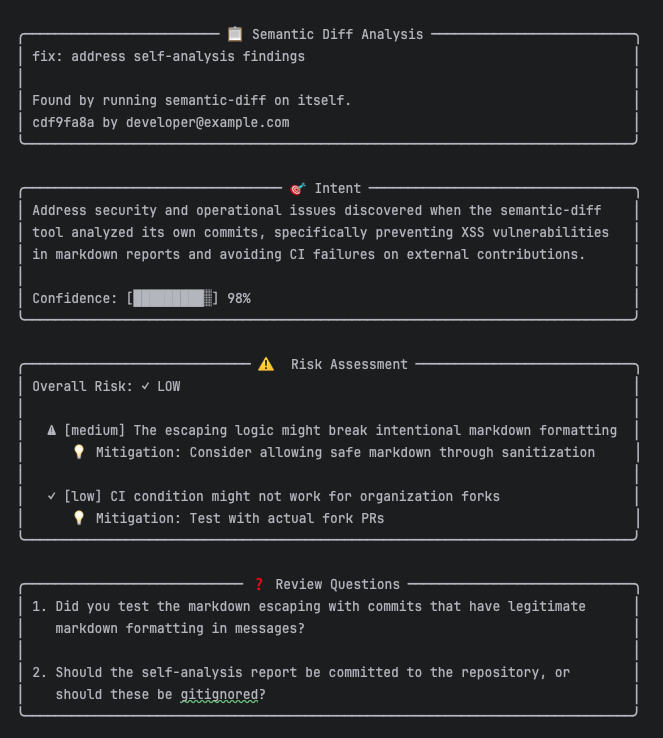
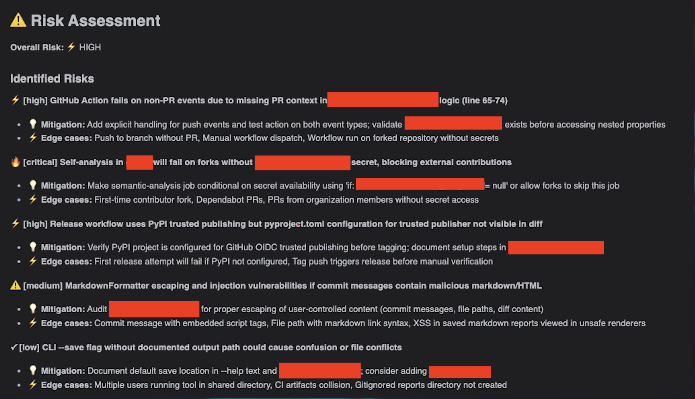

# semantic-diff

[](https://pypi.org/project/semantic-diff/)
[](https://opensource.org/licenses/MIT)

AI-powered semantic analysis of git commits and merge requests. Goes beyond `git diff` to show **intent**, **impact**, **risk**, and **review questions** - or runs an agentic review that reads the code around the change.

## What it does

Regular `git diff` shows *what* changed. `semantic-diff` shows:

| | git diff | semantic-diff |
|---|---|---|
| **What** | Lines added/removed | Same |
| **Why** | - | Intent behind the change |
| **Risk** | - | What could break, edge cases |
| **Impact** | - | Direct and indirect effects |
| **Review** | - | Questions to ask the author |

## Installation

```bash
pip install 'semantic-diff[anthropic]'   # Anthropic API (the default provider)
pip install 'semantic-diff[openai]'      # an OpenAI-compatible gateway
```

The core package carries no vendor SDK: an install holds only the client it
was asked for, so a runner meant to talk to one gateway has no other client
to fall back on. Without an extra, the CLI says which one to install.

## Quick Start

```bash
# Set your API key
export ANTHROPIC_API_KEY=sk-ant-...

# Analyze a commit
semantic-diff HEAD

# Enable automatic analysis before every push
semantic-diff init
```

That's it! Now every `git push` will automatically analyze your commits and save reports.

## How It Works

### Manual Analysis

```bash
# Analyze HEAD commit
semantic-diff

# Analyze specific commit
semantic-diff abc123

# Save report to file
semantic-diff HEAD --save

# Output as JSON
semantic-diff HEAD --json
```

### Automatic Analysis (Pre-Push Hook)

```bash
# Install the hook (once per project)
semantic-diff init

# Now every push triggers analysis automatically
git push  # → runs semantic-diff, saves report, then pushes
```

### Reports

Reports are saved to `semantic_diff_reports/` in your project root:

```
my-project/
├── semantic_diff_reports/
│   ├── abc12345_20240115_143022.md         # commit
│   ├── mr_def67890_20240115_152341.md      # semantic-diff mr
│   ├── review_def67890_20240115_160512.md  # semantic-diff review
│   └── ...
├── src/
└── ...
```

Each report includes:
- Commit metadata
- Intent analysis with confidence score
- Impact map (direct and indirect effects)
- Risk assessment with mitigations
- Review questions prioritized by importance
- Diff coverage: which files the model did not see, if any

### JSON output

`--json` prints the analysis to stdout; diagnostics go to stderr, so it pipes
cleanly into `jq`. The output carries a top-level `schema_version` - check it
before reading fields.

**0.3.0 changed the schema (version 2).** Commit fields moved into a nested
`change_set`, which describes either a commit or a merge request:

| 0.2.x | 0.3.0 |
|-------|-------|
| `.commit_hash` | `.change_set.head_sha` |
| `.commit_message` | `.change_set.title` + `.change_set.description` |
| `.author` | `.change_set.authors[]` |
| `.date` | `.change_set.date` (null for merge requests) |

`semantic-diff review --json` has its own schema (`schema_version` 2):
findings are split into `findings` (cited: backed by a rule card and by
evidence that checked out) and `uncited` (informational observations), and
`risk_level` carries the worst severity among the cited findings — the only
value a CI gate should read. See [CHANGELOG.md](CHANGELOG.md) for details.

### GitHub Action

Add to your workflow to analyze PRs automatically. A pull request is analyzed
as a whole (merge base..head, the same diff as the PR's Files tab), with its
title and description as the stated intent - one LLM call per run. On `push`,
the pushed commit is analyzed.

```yaml
# .github/workflows/semantic-diff.yml
name: Semantic Diff

on: [pull_request]

jobs:
  analyze:
    runs-on: ubuntu-latest
    steps:
      - uses: actions/checkout@v4
        with:
          fetch-depth: 0

      - uses: tkenaz/semantic_diff@v0.6.0
        with:
          anthropic_api_key: ${{ secrets.ANTHROPIC_API_KEY }}
          comment_on_pr: true
          fail_on_risk: high  # optional: block merge on high risk
```

| Input | Default | |
|-------|---------|---|
| `anthropic_api_key` | - | Required |
| `model` | `claude-sonnet-5-5` | Any Anthropic model id (`claude-opus-5-5` for deeper reviews) |
| `comment_on_pr` | `true` | Post (or update) one PR comment |
| `fail_on_risk` | `never` | `low`, `medium`, `high`, `critical` or `never` |
| `review` | `false` | Run the agentic reviewer on pull requests (see below) |
| `rules_path` | - | Rule corpus checkout (`INDEX.md` + `rules/*.md`) for cited findings |
| `base_ref` | PR base | Override the base to compare against |

Outputs: `risk_level`, `verdict` (review mode), `analysis_json`, `report_path`.

By default the action runs `semantic-diff mr` against Anthropic: one LLM
call, and `fail_on_risk` reads the analysis's overall risk. With
`review: true` it runs the agentic `review` on pull requests instead; the
PR comment then shows the verdict, cited findings and uncited observations,
and `fail_on_risk` reads **only the cited findings** (`risk_level` in the
JSON): a review without cited findings reports `none` and never fails the
check, however severe the uncited observations are. A review the model never
submitted (a limit cut it short) reports `incomplete` and fails any
threshold: nothing checked means nothing passed. Point `rules_path` at a
rule corpus checked out in the workspace, or every finding stays uncited and
the reviewer is purely advisory. The action does not take an
OpenAI-compatible gateway; for that, call the CLI from your own workflow
step.

## Example Output

### Analysis Overview



*Intent analysis with 98% confidence, risk assessment, and review questions*

### What It Finds



*Real example: semantic-diff analyzing itself found XSS vulnerabilities, CI issues, and security misconfigurations*

## Configuration

Create a `.env` file in your project or set environment variables:

```bash
# Required
ANTHROPIC_API_KEY=sk-ant-...

# Optional
SEMANTIC_DIFF_MODEL=claude-sonnet-5-5  # or claude-opus-5-5
```

In CI (`CI` set, as GitHub Actions and GitLab CI do) the `.env` file is never
read: the working tree there is the change under review, so configure the job
with CI variables instead.

### Model matters

semantic-diff is exactly as good as the model under the hood. The tool packs
the diff, makes the model read the real files and checks every citation
against the base and the head of the change — but the judgement about
intent, risk and what is *missing* comes from the model, and no amount of
tooling adds judgement that is not there.

Recommended: a current frontier model — Anthropic Claude 5 series or newer
(`claude-sonnet-5-5` as the default, `claude-opus-5-5` for `review` on larger
merge requests). That is the maintainer's recommendation, not a measurement:
our own evaluation ran on the models available behind a corporate gateway, a
previous-generation Claude and an open-weights 120B model. Before you trust
verdicts on your codebase, run your own evaluation on a handful of merge
requests your reviewers have already sent back.

What our evaluation showed, in short: a strong model is reliable on defects
in and around the diff, and weak on what the change left out elsewhere and
on what only running the code reveals. The open-weights model missed nearly
everything a human reviewer had found. Weaker models widen that gap. Treat
the output as advisory, not a gate — keep a human on the merge button and
let the tool shorten the reading.

### OpenAI-compatible gateways

Any gateway that speaks the OpenAI Chat Completions protocol (LiteLLM, vLLM,
corporate LLM hubs, OpenAI itself) works through the `openai` provider:

```bash
pip install 'semantic-diff[openai]'

SEMANTIC_DIFF_PROVIDER=openai
SEMANTIC_DIFF_BASE_URL=https://your-gateway.example/v1
SEMANTIC_DIFF_API_KEY=...
SEMANTIC_DIFF_MODEL=claude-sonnet-4.6   # required: model ids differ per gateway
```

Retries (rate limits honour `Retry-After`, timeouts, 5xx) are handled once for
all providers: `SEMANTIC_DIFF_MAX_RETRIES` (attempts, default 3) and
`SEMANTIC_DIFF_MAX_WAIT` (seconds, default 30).

### Diff budget

Large changes are not cut blindly. Diffs are packed into a token budget
(`--max-diff-tokens` / `SEMANTIC_DIFF_MAX_DIFF_TOKENS`, default 60,000):
code first, then migrations, CI/infra, tests, docs. A file that does not fit
whole is trimmed at hunk boundaries, never mid-line. Lock files, generated
output and binaries are listed but never shown. The model is told which files
it did not see, and every report states the coverage, e.g.
`Diff coverage: 87% of changed lines` plus the trimmed/not-shown files.

### Agentic review

`semantic-diff review` goes further than `mr`: instead of one call over the
diff, an agent reads around the change - whole functions, callers, the file
before the change, history - with read-only tools, and submits findings tied
to lines.

```bash
semantic-diff review --base origin/dev --save
semantic-diff review --gitlab-env --json   # inside a GitLab MR pipeline
```

- Tools read git objects at the merge request's head and base, never the
  working tree: uncommitted files are invisible to the model.
- Every review is bounded: `--max-turns` (`SEMANTIC_DIFF_MAX_TURNS`, default
  25), `--max-input-tokens` (`SEMANTIC_DIFF_MAX_INPUT_TOKENS`, default
  1,000,000, cached tokens included) and the diff shown up front
  (`--max-diff-tokens` / `SEMANTIC_DIFF_REVIEW_DIFF_TOKENS`, default 30,000).
  When a limit is reached the model gets one last turn to submit what it has,
  and the report says which limit cut the review short.
- Each finding is checked in code: does the cited line exist (after the
  change, or only before it), and did the model actually see the file. The
  report flags findings that fail either check.
- Works with both providers: Anthropic (the default; just
  `ANTHROPIC_API_KEY`) and any OpenAI-compatible gateway
  (`SEMANTIC_DIFF_PROVIDER=openai`). Prompt caching is used on both, so each
  turn re-reads the conversation from cache.
- Secrets and personal data are erased before the model sees them (on by
  default; `--no-redact` turns it off): the diff, title, description, commit
  subjects and everything the tools read go through one
  [pii-eraser](https://github.com/tkenaz/pii-eraser) session, so a value
  keeps one placeholder everywhere and line numbers still hold. The report
  says how many values were erased. `mr` and `analyze` do not redact yet.
- Files where secrets live by convention are never read by the tools,
  whatever their contents: `read_file` and `read_base` refuse them and
  `grep` leaves their hits out (and says how many). Redaction is then a
  second layer, not the only one. A changed file of this kind still reaches
  the model through its diff, erased like every other diff. The defaults:
  `.env`, `.env.*`, `*.pem`, `*.key`, `*.p12`, `*.pfx`, `*.jks`, `*.keystore`, `id_rsa*`, `id_dsa*`, `id_ecdsa*`, `id_ed25519*`, `.netrc`, `.npmrc`, `.pypirc`, `.git-credentials`, `credentials`, `credentials.*`, `*.tfvars`, `*.tfstate`, `*.tfstate.*`, `secrets/*`, `*/secrets/*`.
  A pattern without `/` matches the file name in any directory; one with `/`
  matches the path from the repository root. Add more with `--withhold GLOB`
  (repeatable) or `SEMANTIC_DIFF_WITHHOLD` (space-separated).
- `--gitlab-comment` posts the review to the merge request as one note and
  edits that same note on every later run (it carries a hidden marker; only
  notes by the token's own user are matched). The token comes from
  `SEMANTIC_DIFF_GITLAB_TOKEN` (`CI_JOB_TOKEN` cannot write notes): a project
  access token with the `api` scope and the Reporter role is enough. The note
  shows the verdict and the cited findings; uncited high-severity findings stay
  in the open, each with the reason it is uncited (without `--rules` that is
  every finding), and the rest are folded away. Posting is advisory: if it fails, the job warns and goes on.

#### Cited findings and the rule corpus

The review's output has two channels. `findings` holds **cited** findings:
each one names a rule card (`rule_id` + its `source` line, copied verbatim
from the card) and quotes the diff line(s) it rests on as `evidence`.
Everything else - observations no card covers, citations of cards that do
not exist, findings whose evidence did not check out - lands in `uncited`,
with honest severity, as information for the reviewer. Only cited findings
feed `risk_level`, the value CI gates read; uncited observations never flip
a pass to a fail.

Point `--rules` (env `SEMANTIC_DIFF_RULES`) at a corpus directory holding
`INDEX.md` (a signal → tags table) and `rules/*.md` (atomic cards headed
`### [ID] Title` with a `source:` line, citing a public standard such as
OWASP ASVS or GDPR). The model gets `INDEX.md` up front and
loads only the rule files the diff's signals earn (a `read_rules` tool);
every submitted `rule_id` is verified against the corpus in code, so an
invented citation is demoted to `uncited` and flagged. Without `--rules`
every finding is uncited and the review is advisory - nothing gates.

```bash
semantic-diff review --base origin/dev --rules ./skills/compliance-review --save
```

## Commands

| Command | Description |
|---------|-------------|
| `semantic-diff` | Analyze HEAD commit |
| `semantic-diff <hash>` | Analyze specific commit (long form: `semantic-diff analyze <hash>`) |
| `semantic-diff mr --base origin/main` | Analyze a whole merge request (merge-base..HEAD) |
| `semantic-diff mr --gitlab-env` | Same, inside a GitLab MR pipeline (reads `CI_MERGE_REQUEST_*`) |
| `semantic-diff review --base origin/main` | Agentic review of a merge request (see above) |
| `semantic-diff init` | Install pre-push hook |
| `semantic-diff uninstall` | Remove pre-push hook |

Options for `analyze`, `mr` and `review`:

| Option | Description |
|--------|-------------|
| `--save`, `-s` | Save report to `semantic_diff_reports/` |
| `--json` | Output as JSON (see [JSON output](#json-output)) |
| `--model`, `-m` | Model id (overrides `SEMANTIC_DIFF_MODEL`) |
| `--repo`, `-r` | Path to the git repository (default: current directory) |
| `--verbose`, `-v` | Progress and errors in detail, on stderr |
| `--brief`, `-b` | Intent, risk and top questions only (`analyze`, `mr`) |
| `--max-diff-tokens N` | Diff budget for the prompt (default 60000; 30000 for `review`) |
| `--max-output-tokens N` | Room for the model's answer (default 32000; env `SEMANTIC_DIFF_MAX_OUTPUT_TOKENS`; `analyze`, `mr`) |

Picking the range for `mr` and `review`:

| Option | Description |
|--------|-------------|
| `--base REF` | Target branch the MR merges into (required unless `--gitlab-env`) |
| `--head REF` | Source ref (default: `HEAD`) |
| `--title TEXT` | MR title - the strongest intent signal |
| `--description-file PATH` | File with the MR description |
| `--gitlab-env` | Read base, head, title and description from GitLab MR pipeline variables |

`review` adds `--max-turns`, `--max-input-tokens`, `--rules` and
`--gitlab-comment` (see [Agentic review](#agentic-review)), and `--transcript FILE`: the whole review
conversation as JSON lines, for diagnosing a missed defect.

## Development

```bash
git clone https://github.com/tkenaz/semantic_diff.git
cd semantic_diff
pip install -e ".[dev]"
pytest
```

## Support

- **Bug reports & features**: [GitHub Issues](https://github.com/tkenaz/semantic_diff/issues)
- **Custom integrations or enterprise**: [mv@37lab.ai](mailto:mv@37lab.ai)

## License

MIT — [37lab](https://37lab.ai)

---

*Built with 🖤 by [37lab](https://37lab.ai) — AI tools for developers*
